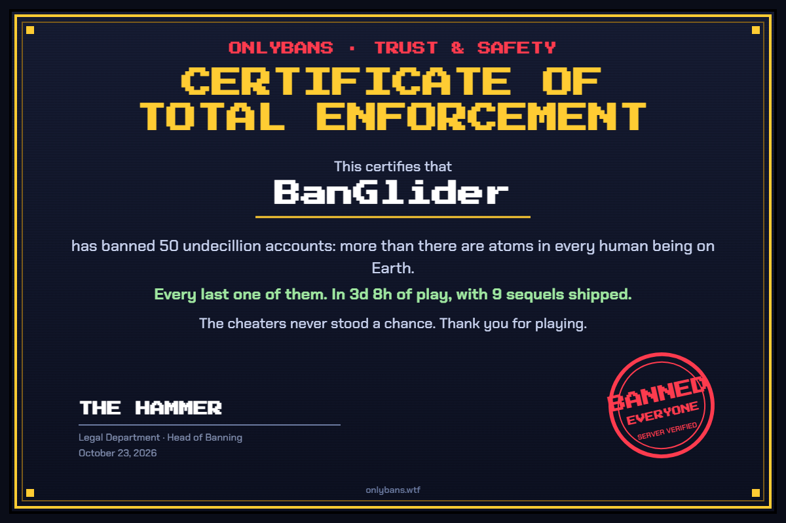

# OnlyBans Glider

Tampermonkey userscript for https://onlybans.wtf. It plans the most efficient purchases and, with AUTO on, buys them and plays the game's mechanics by clicking the game's own UI.

Every action is a click on the game's DOM, so it goes through the game's input recorder and replays on the server like a human's input. The script never calls game logic to change state.

BanGlider was World First to the 5e37 cap (Full Enforcement) on 2026-10-23: 3 days 8 hours of play, 9 sequels, server verified. On 2026-10-25, OnlyTAS ran a fresh game to the cap in 2 hours 58 minutes with 7 sequels, server verified ([certificate](research/full-enforcement-2026-10-25.png)).



## Install

1. Install Tampermonkey. In Chrome, also enable "Allow User Scripts" on the extension's details page, and check Tampermonkey itself is Enabled.
2. `npm run release` (build, unit tests, panel layout check).
3. Tampermonkey dashboard → Utilities → import `dist/onlybans-glider.user.js` (or paste it into a new script).
4. Reload onlybans.wtf. The panel appears at the left edge. Drag it by its header; it stays anchored to the nearer edge.

## Using it

- **Next**: the purchase to make now. A recommended building also gets a green outline in the store.
- **AUTO** (header button, red when on): buys the plan's buy-now list (up to 15 clicks per cycle, one upgrade per cycle), picks arms race upgrades, buys utility upgrades, and runs everything enabled under Automation.
- **Anti anti-cheat** (top of Automation, on by default): only clicks what a person could see and reach (nothing under a game pop-up or off screen), with human reaction delays, a bursty hammer, and gaps between purchases. Turn it off for instant reactions and a steady 14 clicks/s hammer (just under the game's 15/s auto-clicker flag).
- **Automation** section: one checkbox per game mechanic (hammer clicker, golden reports, ban waves and audits, the Lever, coffee, weekends, incidents, minigames, and more). Turn off a whole mechanic here; strategy within a mechanic is fixed by simulation and is not configurable.
- **Horizon / Depth / Clicks/s**: planner settings. Defaults come from simulating the first 2 game-hours of a fresh run; adjust them for later phases. Clicks/s is overridden by the hammer clicker while it runs.
- **Stats** section (bottom): wave verdicts, per-minute snapshots, and action counts, stored in IndexedDB. **Copy JSON** exports them. **Show graph** opens a floating window (drag by its title bar, resize from the corner) with all-time bans and earned/s for the whole run, sequel ships and golden boosts marked; it keeps collecting while closed.
- The panel warns when the live game build differs from the one the automation was last checked against (`ANALYZED_BUILD`).
- Not automated: Ship a Sequel (prestige), seed funding, and prestige upgrades.

## How it works

The script re-imports the game's own ES module, so it reads the live building and upgrade tables and the game's logic API (`calculateGains`, `buildingPrice`, `upgradePrice`). Exports are found by content, not by their minified names, so binding survives game updates.

To value a purchase, the planner applies it to the live state, runs the game's `calculateGains`, reads the result, and restores the state, all in one synchronous block. Temporary buffs (Ban wave, Launch Day, etc.) are excluded, so advice holds steady during events. The planner (`src/planner.js`) tests short purchase sequences, including "buy N more of a department to unlock its upgrades" bundles, and picks the one that maximizes `bank(H) + rate(H) * H`.

## When the game updates

```
bash scripts/fetch.sh                 # download the current bundle and index.html; did it change?
python3 -I scripts/feature-scan.py    # new or removed game features vs FEATURES.md
python3 -I scripts/bundle-diff.py OLD NEW   # what changed between two builds
```

After re-checking the automation against a new build, update `ANALYZED_BUILD`. The ⟳ button replans without reloading; a game update needs a page reload.

## Dev

- `npm test`: planner unit tests.
- `npm run release`: build, tests, and the headless browser checks (panel layout, anti anti-cheat). Run before every build you install, and bump `@version` in `src/header.txt`.
- `npm run sim -- --minutes 60 --seed 1 [--set key=value]`: offline simulator. Runs the real game bundle in Node with a fake clock and the userscript loaded, then prints a JSON summary. The preferred way to test automation changes.
- `npm run experiments -- MINUTES SEEDS SET`: run a named set of configs in parallel and compare scores. `npm run progress` shows live progress.
- `FEATURES.md`: every game feature and what the automation does with it.
- `CLAUDE.md`: project notes, mechanics reference, and the work queue.
